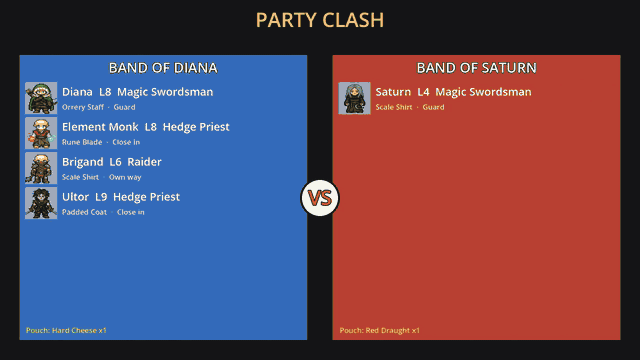
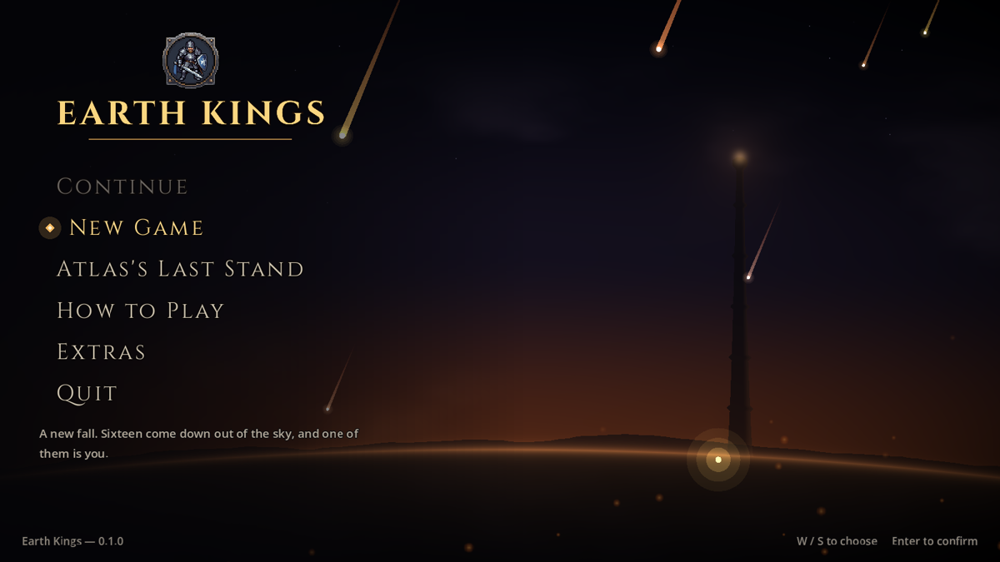
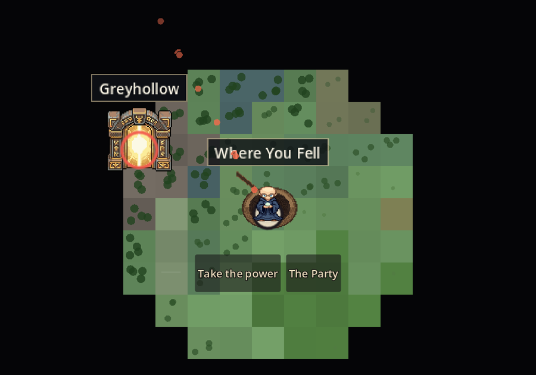

# Earth Kings

  

**A tactical RPG in a hostile world where characters die for good.** Sixteen demigods fall into
sixteen copies of Earth and forget who they were. You are one of them: walk a generated land tile
by tile, gather a company, shut the gates that spill monsters into the world, and climb the
hundred-floor Tower at its centre towards a contest only one world survives. When you fall, your
world ends, and you go on as another of the sixteen, in theirs, from level 1.

**Play it free in your browser, or download it for Windows, macOS, Linux:
[willjkdouglas.itch.io/earth-kings](https://willjkdouglas.itch.io/earth-kings)**

  
  

## Where it is

In development, and played on every new build by the two people making it. What plays today is
the **First Hour**: Atlas falls into a crater, walks to the Tower's city, shuts the first gate and
climbs the Tower's first floors to the end of his first chapter. The Second Hour, floors six to
ten, follows it. Fights are real time with pause, on a grid, with a mouse, a controller or a phone's
touch screen.

## Who makes it

Two founders, Will (`dougie`) and Ewan (`doug-md`). It is built in [Godot](https://godotengine.org).

## What is in this repository

This is the project's public face, not its source. It holds:

- this page and its pictures;
- [CREDITS.md](CREDITS.md): the engine, the music, and every outside sound, picture and font, with
  their licences;
- [AI.md](AI.md): what in the game was made with AI, and how.

The game's code, art and design notes are kept in a private repository. Nothing here, and nothing
in the builds, is offered for reuse unless a licence file in this repository says otherwise.

This repository is written by a publish job from the private one; changes made here directly are
overwritten.
