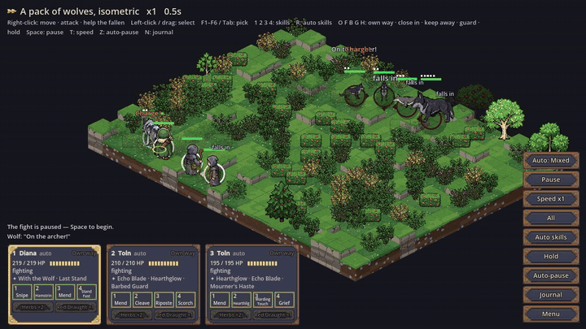
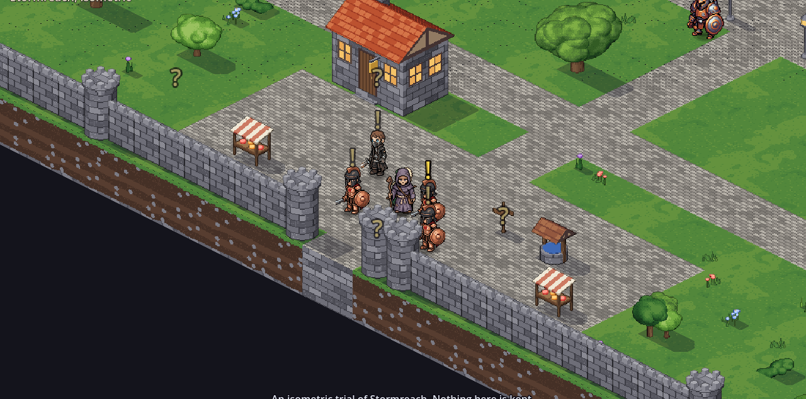
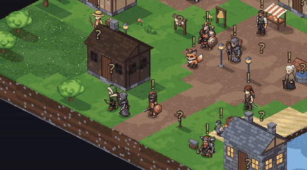
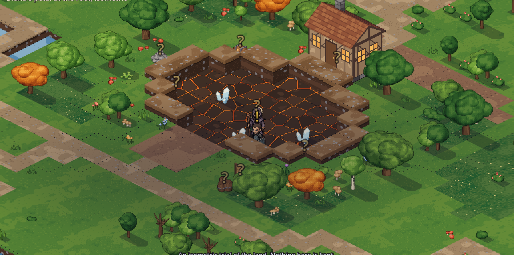
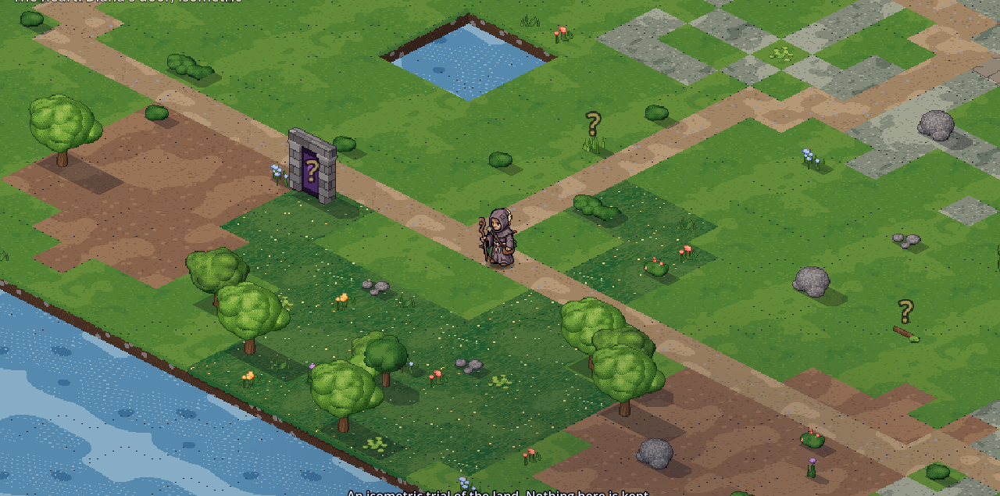

# Earth Kings

  

**A tactical RPG in a hostile world where characters die for good.** Sixteen demigods fall into
sixteen copies of Earth and forget who they were. You are one of them: walk the land tile by tile,
gather a company, shut the gates that spill monsters into the world, and climb the hundred-floor
Tower at its centre towards a contest only one world survives. When you fall, your world ends, and
you go on as another of the sixteen, in theirs, from level 1.

**Play it free in your browser, or download it for Windows, macOS, Linux:
[willjkdouglas.itch.io/earth-kings](https://willjkdouglas.itch.io/earth-kings)**

  
  

  
  

## Where it is

In development, and played on every new build by the two people making it. The first twenty
floors of the Tower play end to end: you come down in a crater, are pulled out by a stranger called
Bram, walk to the city at the Tower's foot, shut your first gate and climb, finding a chapter of who
you were every five floors. The company fights in real time with pause; the one you play is also
fought by hand, with a dodge, a lock-on and stamina. It plays with a mouse, a controller or a phone's
touch screen.

What is new lately:

- **A Test lab** on the title screen: short slices of the game, each played on its own, with your
  voice and notes sent straight to the makers at the end.
- **An isometric look**, on trial beside the view from above: every land of the game, its villages,
  the city and the weather, all drawn at a tilted angle.
- **A new shape for the world**: one Tower at the heart, and round it a land of their own for each
  of the sixteen. It is being built now.
- **Villages with life in them**: people who stroll to the well and the stalls, stop to talk and
  watch you pass.
- **Chapters three and four** for all sixteen, found on floors 15 and 20.

## Who makes it

Two founders, Will (`dougie`) and Ewan (`doug-md`). It is built in [Godot](https://godotengine.org).

## What is in this repository

This is the project's public face, not its source. It holds:

- this page and its pictures, all taken from the game;
- [CREDITS.md](CREDITS.md): the engine, the music, and every outside sound, picture and font, with
  their licences;
- [AI.md](AI.md): what in the game was made with AI, and how.

The game's code, art and design notes are kept in a private repository. Nothing here, and nothing
in the builds, is offered for reuse unless a licence file in this repository says otherwise.

This repository is written by a publish job from the private one; changes made here directly are
overwritten.
